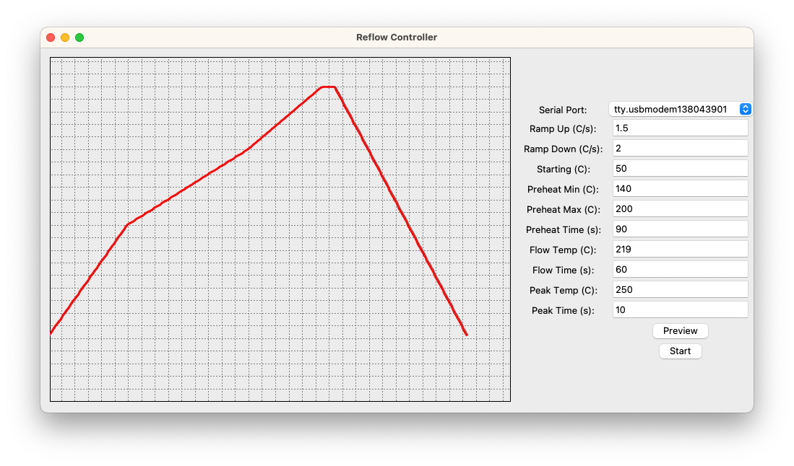

reflow_oven
===========



A simple, two-part reflow oven controller built from a toaster oven:
- Python GUI (Tkinter) that generates an IPC/JEDEC-style reflow temperature profile, streams target temperatures once per second, and plots actual vs desired in real time.
- Arduino-based temperature controller that reads a K‑type thermocouple via MAX6675 and toggles the heater using basic hysteresis control.

### Features
- **Realtime plot**: Desired vs actual temperature on a simple canvas.
- **Parametric profiles**: Preheat, soak, reflow peak, and cool-down durations and temperatures.
- **Serial control**: Sends `set_temp` once per second, reads actual temperature back.
- **Preview mode**: Visualize the generated profile without hardware.

### Hardware
- Toaster oven converted for reflow (use a proper SSR/relay rated for mains voltage and current).
- Arduino (Uno/Nano or similar) with MAX6675 thermocouple amplifier and K-type probe.
- Zero-cross detection input (see `arduino/arduino.pde`).
- Indicator LEDs (optional) for status and heater activity.

Pin assignments (Arduino): see `arduino/arduino.pde` for definitive mapping.
- `thermoDO=10`, `thermoCS=11`, `thermoCLK=12`, `thermoVCC=9`, `thermoGND=8`
- `heater=13` (drives SSR/relay), `zeroCross=2`, `led=4`, `relayLed=5`

### Firmware
The Arduino sketch lives in `arduino/arduino.pde` and implements a simple line-based serial protocol at 9600 baud.
- Commands (newline-terminated):
  - `temp` → prints current temperature in °C
  - `set_temp <float>` → sets target temp; replies with current temp
  - `start` / `halt` → enable/disable heater control (reply `ack`)
  - `set_hyst_high <float>` / `set_hyst_low <float>` → set hysteresis (reply `ack`)
  - `get_temp` / `get_hyst_high` / `get_hyst_low` → query values
- Thermocouple reads are rate-limited by MAX6675 conversion time (~220 ms).

### Software
- Python 3 with Tkinter GUI.
- Main entry: `main.py`
- Core modules: `reflow.py` (profile generation), `profile_widget.py` (plotting), `temperature_controller.py` (serial I/O)

### Requirements
Install Python dependencies:

```bash
pip install -r requirements.txt
```

`requirements.txt` includes: `future`, `iso8601`, `pyserial`, `PyYAML`.

Tkinter usually ships with system Python; on some Linux distros you may need:
- Debian/Ubuntu: `sudo apt-get install python3-tk`

### Running
1. Connect the Arduino reflow controller via USB.
2. Ensure the serial device appears under `/dev` (e.g., `/dev/ttyUSB0`, `/dev/ttyACM0`).
3. Start the GUI:

```bash
python3 main.py
```

Notes:
- On startup, the app enumerates `/dev` and offers ports matching `tty[.U]` in the dropdown. If your device name isn’t listed, type or adapt detection as needed.
- Press **Preview** to visualize the profile with current parameters (no hardware required).
- Press **Start** to send the generated profile to the controller once per second. The plot updates with actual readings.

### Profile Parameters
All parameters are editable in the right-hand panel. Defaults in `main.py`:
- **Ramp Up (°C/s)**: default 1.5
- **Ramp Down (°C/s)**: default 2.0
- **Starting (°C)**: default 50
- **Preheat Min/Max (°C)**: defaults 140 / 200
- **Preheat Time (s)**: default 90
- **Flow Temp (°C)**: default 219
- **Flow Time (s)**: default 60
- **Peak Temp (°C)**: default 250
- **Peak Time (s)**: default 10

Profile generation is implemented in `reflow.py::Reflow.reflow(...)` and returns a list of target temperatures at one-second granularity.

### Serial Protocol Details
The GUI communicates via `temperature_controller.py`:
- Sends ASCII commands with newline terminator.
- Parses single-line responses and converts to `float` when applicable.
- Uses a 1s timer loop to `set_temp` and sample actual temperature.

### Data & Logging
- Console prints `second,actual,expected,error%` for each step once expected > 0. Redirect stdout to a file if you want CSV logs:

```bash
python3 main.py > run.csv
```

### Troubleshooting
- Tkinter missing: install `python3-tk` from your distro.
- No serial ports listed: confirm your device path in `/dev`, udev permissions, and update the port filter in `main.py` if needed.
- Temperature reads `err` or 0: check MAX6675 wiring and allow ~500 ms after power-up.
- Heater stuck ON/OFF: validate SSR wiring and `set_temp` values; verify `start`/`halt` behavior.

### Safety
- This project controls mains voltage heaters. Use at your own risk.
- Always enclose high-voltage components, use appropriate fusing, strain relief, and a grounded chassis.
- Never leave the oven unattended. Keep a fire extinguisher nearby. Monitor temperatures with an independent thermometer when validating.

### Roadmap / Ideas
- Improve serial port detection on Linux/macOS/Windows.
- PID control instead of simple hysteresis.
- Save/load profiles (YAML/JSON), export CSV logs.
- Better graphing with Matplotlib; autoscaling and axes labels.

### License
MIT — see `LICENSE`.

